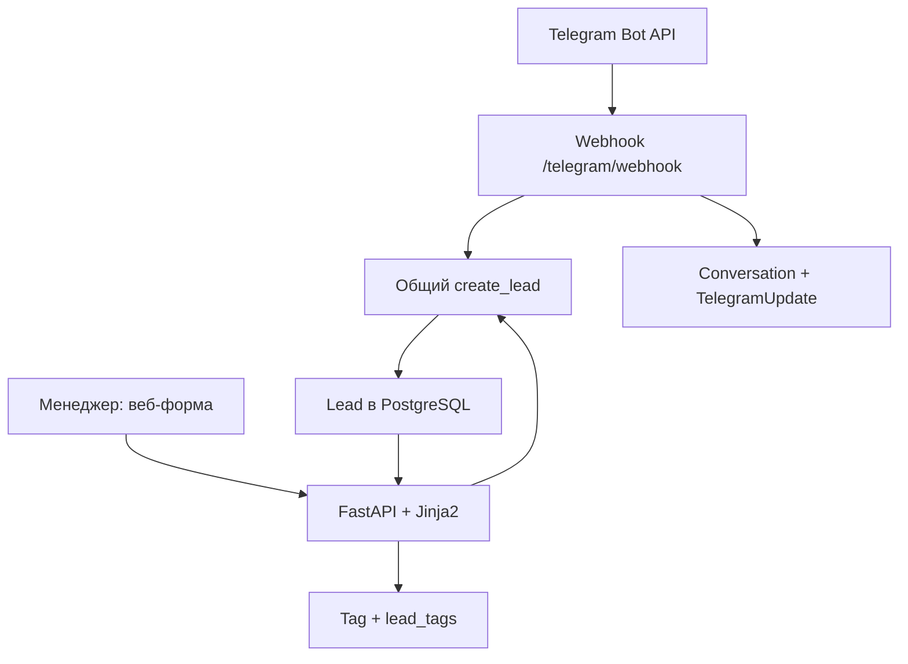

# Архитектура

Один процесс FastAPI и одна PostgreSQL-база. Jinja2 отдаёт HTML, формы выполняют обычные POST с последующим redirect. Сборщика frontend, SPA и фоновой очереди нет. HTTPS завершается в Caddy; наружу открыты только 80/443, PostgreSQL и приложение доступны во внутренней Docker-сети.

| Компонент | Ответственность |
| --- | --- |
| `app/config.py` | Environment, проверка production-конфигурации |
| `app/db.py`, `app/models.py` | SQLAlchemy, схема, связи и состояние диалога |
| `app/leads.py` | Общая валидация и создание Lead, выборка по тегу |
| `app/main.py` | CRM, аутентификация, формы, health, ошибки БД |
| `app/security.py` | Подписанный CSRF-токен с ограниченным сроком |
| `app/telegram.py` | Webhook, шаги диалога, дедупликация и доставка ответа |
| `scripts/setup_webhook.py` | Настройка и проверка webhook через Bot API |

## Данные и надёжность

Lead содержит `id`, `name`, `contact`, `request`, `source`, nullable `telegram_chat_id`, `created_at`. Tag — `id`, уникальное `name`; `lead_tags` — составной первичный ключ из двух внешних ключей. Источник проверяется как в Pydantic, так и ограничением БД.

Состояние Conversation привязано к chat_id и хранит текущий шаг, имя и контакт. TelegramUpdate имеет первичный ключ update_id, ответ и флаг доставки. Обновление состояния, создание лида и запись ответа происходят в одной транзакции. Повтор update возвращает сохранённый результат. Если отправка ответа не удалась, сервер возвращает 503: Telegram повторит update, не создавая второй Lead. Ответ отправляется после коммита. При потере ответа сети после фактической отправки Telegram клиент может увидеть повторную реплику; гарантия ровно одного исходящего сообщения не заявляется.

`max_connections=1` упрощает порядок webhook-доставки. PostgreSQL advisory transaction lock сериализует короткие изменения intake и тегов, SQLite использует BEGIN IMMEDIATE. Сетевой вызов выполняется за пределами блокировки. Это сознательный компромисс для малого агентства; для большого потока нужны блокировки на чат, очередь и независимая доставка. Bot API не даёт общей гарантии сохранения порядка всех пользовательских сообщений; бот рассчитан на ответы по одному после его вопроса.

CRM защищена HTTP Basic поверх HTTPS. Формы используют HMAC-токен; Telegram webhook использует отдельный secret header. Jinja2 экранирует пользовательский текст. Health не раскрывает данные. Секреты читаются только из environment/.env, production access logs отключены. Body limit на production-прокси — 64 KB.

Начальная схема создаётся `create_all` при запуске одного worker. Это bootstrap первого деплоя, не система миграций: существующую схему таким способом не изменять. Backups PostgreSQL — обязанность оператора. Журнал TelegramUpdate в MVP не очищается, чтобы не потерять дедупликацию; объём хранения стоит контролировать.

## Добавление обычного Telegram-аккаунта

Отдельный worker на Telethon или Pyrogram авторизуется через MTProto с `api_id`, `api_hash` и защищённой session. Он получает разрешённые входящие сообщения, определяет поля заявки и вызывает тот же `create_lead(LeadInput(..., source='telegram_account'))`. Для worker создаётся отдельная таблица ExternalMessage с уникальной парой account_id/message_id; сохранение идентификатора и Lead выполняется одной транзакцией. Webhook Bot API остаётся без изменений. MTProto-сессия даёт доступ к аккаунту: хранить её вне Git как секрет, обеспечить 2FA, ограничить перечень чатов, проверить согласие на обработку переписки. Авторизация и извлечение полей из произвольного сообщения требуют отдельного пользовательского сценария и не входят в данный MVP.
